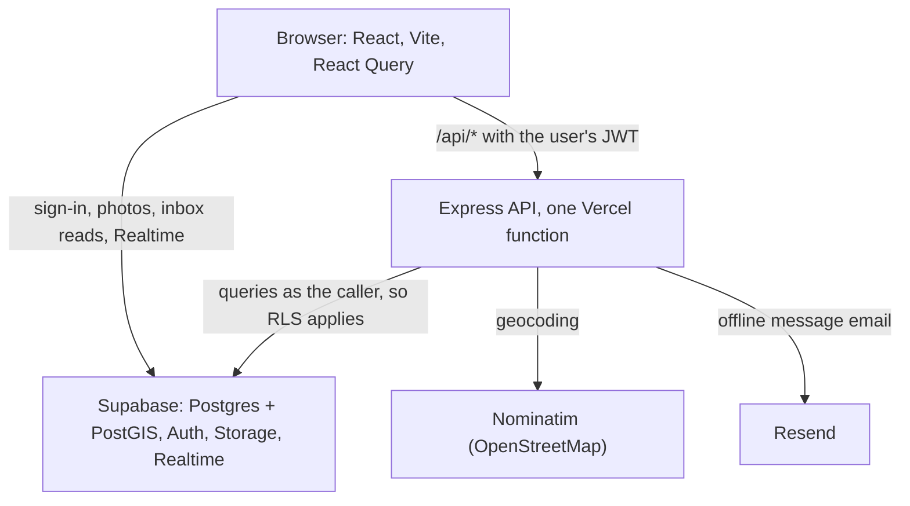

# LetMeKnock

Student housing for Canadian universities, launching at McMaster. Landlords post rentals near campus; students search by distance from campus, filter, save places and message landlords.

**Live site:** LIVE_URL

## Try it in a minute

1. Open the live site and click **Sign in**, then **Demo student** (or use `demo-student@example.com`, password `letmeknock-demo`).
2. On the home page, type `2 bedroom under $1500 near campus` into **Describe your place** and press Search.
3. Remove a chip like "Under $1500" to widen the search, or switch to **Map** to see the same search around campus.
4. Open a listing and press **Message landlord**. The envelope in the navbar shows unread replies; the demo student already has one.

| Demo account | Email | Password |
| --- | --- | --- |
| Student | `demo-student@example.com` | `letmeknock-demo` |
| Landlord | `demo-landlord@example.com` | `letmeknock-demo` |

Demo data is shared and reset from time to time.

## What it does

- **Search by distance:** listings within 1, 2, 5 or 10 km of campus, nearest first, on a list or a map. Pan the map and search just that area.
- **Describe your place:** a sentence like "furnished studio within 1 km, pet friendly" becomes filters, shown as removable chips.
- **Filters in the URL:** every search is a link you can refresh, share, or switch between list and map without losing.
- **Messaging:** one conversation per listing between a student and the landlord, live updates, unread badge, and an email when the other person is away.
- **Listings:** landlords create and edit listings with up to 10 photos and a Canadian address, geocoded to a map point.
- **Favorites** with private notes and named collections.

## Architecture



- **One definition of every data shape** in `shared/schema.ts` (Zod), used by the browser, the API and the tests. Database rows are converted only in `shared/mappers.ts`.
- **Access control lives in Postgres** row level security. The API calls Supabase as the signed-in user rather than as an admin, so a bug in a route can't read or write someone else's rows. Every policy has a test.
- **The API owns listing writes and search:** it verifies the token, validates input (400 with a message per field), rate limits, and geocodes addresses.
- **Radius search runs in SQL:** a generated PostGIS `geography` column with a GiST index, and one `search_listings` function for distance, filters, sort and limit.
- **Public pages are prerendered:** the build renders the home, listings and info pages to static HTML with React's streaming server renderer, and the browser hydrates them, so phones see content before any JavaScript runs.

## Technical decisions

The full log, with context and tradeoffs, is in [`DECISIONS.md`](DECISIONS.md). Highlights:

- **The API acts as the caller, not as an admin.** RLS still applies to every query, and the routes check ownership again (defense in depth).
- **SQL search is tested against a TypeScript reference.** 200 seeded random searches must return the same listings in the same order from `search_listings` and from `searchInMemory`. Two bugs planted in the SQL on purpose both made it fail.
- **plpgsql over plain SQL for the search function,** so each call is planned with real values and the spatial index can be used.
- **Rule-based natural-language search instead of a model:** free, predictable and fully unit tested, at the cost of only understanding phrasings it has rules for.
- **Prerender, then hydrate only exact matches:** a page is hydrated only when its HTML was rendered for that exact URL; filtered URLs render fresh, so there are no hydration mismatches.
- **One email per batch of unread messages:** the API emails only when the receiver hasn't been seen for 5 minutes and this is their first unread message in the conversation.

## Measured numbers

| What | Result | How it was measured |
| --- | --- | --- |
| Radius search, 2 km around campus | 21.02 ms median without the spatial index, 0.91 ms with it | `npm run bench:search`: 50,000 seeded listings, 200 timed runs each, alternating blocks, PGlite (Postgres in WASM) on a laptop |
| JavaScript needed for first render | 298.6 kB gzip before code splitting, 188.9 kB after, 170.9 kB after the redesign removed Framer Motion | `npm run build` output (main and vendor chunks) |
| Mobile load, home page | LCP 2,904 ms to 1,873 ms; performance 88 to 97-98 | Lighthouse 13.5, real slow-4G and 4x CPU throttling, same build served as an empty shell vs prerendered, 3 runs each, medians. Measured before the interface redesign |
| Mobile load, listings page | LCP 3,005 ms to 1,747 ms; performance 84-89 to 97-99 | Same A/B |
| Lighthouse accessibility | 100 on home, listings and map | Lighthouse 13.5, production build, 3 runs each. Measured before the interface redesign |
| Lighthouse performance, desktop | 94 to 98 | Same |
| Automated checks | 181 unit and API tests, 121 database policy checks, 3 PostGIS search tests | `npm run ci` |

Lighthouse and the benchmark ran locally, not against the live site.

## Running it locally

Requires Node 20.6 or later and a Supabase project.

1. Install dependencies:

   ```bash
   npm install
   ```

2. Copy `.env.example` to `.env` and fill in the values from your Supabase project (Project settings > API).

3. Run each file in `supabase/migrations/` in filename order in the Supabase SQL editor. They are safe to run more than once, and the location search migration enables PostGIS.

4. Create the demo accounts, sample listings (geocoded through OpenStreetMap, about 10 seconds) and a demo conversation. This also resets them:

   ```bash
   npm run seed
   ```

5. Start the app and API at `http://localhost:5000`:

   ```bash
   npm run dev
   ```

Offline message emails are optional; see the comments in `.env.example`.

## Checks

```bash
npm run ci            # everything below, the same steps GitHub Actions runs
npm run check         # type check
npm test              # unit and API tests
npm run test:db       # row level security and PostGIS search tests against in-memory Postgres
npm run build         # production build
npm run bench:search  # spatial index benchmark
```

## Credits

Address geocoding by [Nominatim](https://nominatim.org/). Map tiles and data © [OpenStreetMap](https://www.openstreetmap.org/copyright) contributors. Maps with [Leaflet](https://leafletjs.com/).
